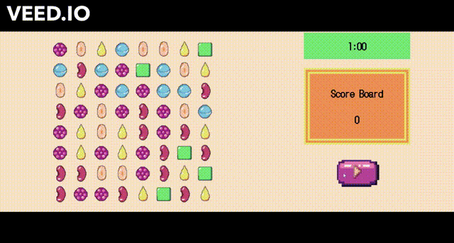

# Match Three Game 🍭

## Este es un juego clon de Candy Crush creado con el propósito de afilar mis habilidades en JavaScript y CSS.

### ¡La base de este repositorio proviene de [este tutorial de YouTube](https://www.youtube.com/watch?v=XD5sZWxwJUk)!

### [Registro de Cambios](CHANGELOG.md)

---

### CÓMO JUGAR

- Inicia el juego presionando el botón de reproducción.
- Tienes 60 segundos para completar el juego.
- Arrastra y suelta los dulces para emparejarlos.
- Solo puedes arrastrar y soltar hacia la derecha, izquierda, arriba y abajo.
- Empareja al menos 3 dulces en una fila o columna para obtener puntos.
- Crea combinaciones emparejando más de 3 dulces.
- Haz clic en el cuadro del temporizador para evitar que rebote.

### ¡Júgalo [aquí](https://alexandria.github.io/match-three-game/index.html)!

---

### Ejecutarlo localmente
- Clona este repositorio 
- Abre el archivo `index.html` en tu navegador preferido, ya sea haciendo doble clic en el archivo en el explorador o arrastrándolo y soltándolo en la barra de búsqueda del navegador.

---

### Ejecutar ESlint

- Instala Node.js

- Instala las dependencias

```
npm install
```

- Ejecuta eslint en la carpeta de scripts

```
npm run eslint
```

Algunas reglas se corregirán automáticamente, otras se registrarán para que el desarrollador las corrija manualmente.

---

### Dónde estoy ahora 🍬

- Funcionalidad básica de arrastrar y soltar
- Las filas se reemplazan cuando se emparejan
- Seguimiento del puntaje
- Emparejamiento de 5+ filas y columnas
- Fondo con estilo
- Animación simple cuando el dulce desaparece
- GitHub Pages
- Implementar un límite de tiempo
- Tener un botón de "Inicio" y Reinicio
- Corregir el error que hace que el juego falle en el dulce de la esquina inferior derecha



### Características Futuras 🧁

- Actualizar imagen de fondo
- Paleta de colores más cohesiva

### Créditos de Arte y Recursos
- Dulces con temática de Halloween de [silverwavetidaldragon](https://github.com/silverwavetidaldragon) 

#### Este proyecto está licenciado bajo los términos de la [licencia MIT](https://choosealicense.com/licenses/mit/#).
